# INS Live

把一张生活照，做成有设计感、动效明显的循环照片。

这是一个供 Codex 等支持本地 Skill 的 Agent 使用的创作流程：先读图、对照参考、提出 **3 个文字方案**，你选定后，再制作静帧、分层动画与最终文件。适合音乐卡片、手绘互动、漂浮字母、专注模式和透视地图等 INS 风格动效。

<p align="center">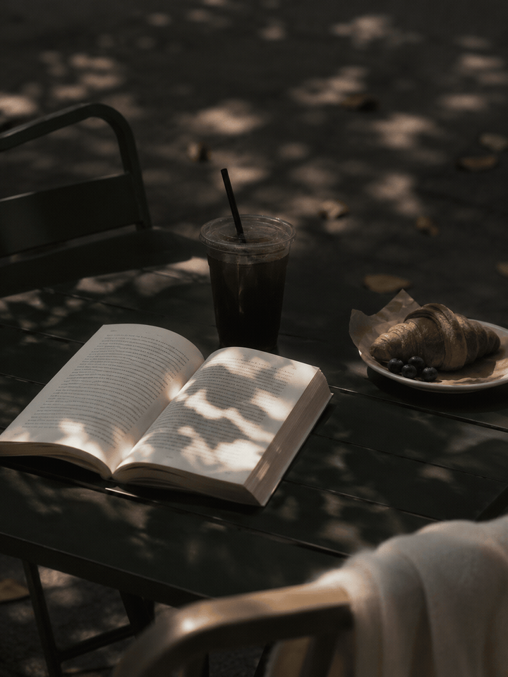</p>
<p align="center"><a href="examples/under-the-trees/animation.mp4">查看 MP4</a> · <a href="#全部动图案例">22 个动图案例</a> · <a href="SKILL.md">阅读完整 Skill</a></p>

## 怎么使用

将仓库安装到 Codex 的本地技能目录（目标目录应不存在）：

```bash
git clone https://github.com/xintu1314/ins-live.git ~/.codex/skills/ins-live
```

在支持读取本地 Skill 的 Codex 会话中附上一张照片，输入：

> 用 $ins-live 给这张图做一个 INS 动效。先给我三个文字方案，等我选定再制作。

也可以明确指定方向：

> 用 $ins-live 做灰色磨砂音乐播放器，保留原照片，直接生成循环 GIF 和静音 MP4。

它是 **Agent 技能与参考库**，不是输入图片就自动完成所有效果的独立软件。具体绘图、分层和渲染由 Agent 使用可用工具完成；需要原创位图素材时，也需要图片生成能力。附带脚本需要 Python 3、FFmpeg 和 ffprobe；无需付费 Python 依赖。

## 创作原则

- **先选方案，再做一版。** 新图是新任务；不把上一张图的选择套到下一张。
- **参考先行。** 从整个效果库挑适合照片的方向，不总是重复同三个选项。
- **大到看得见。** 在约 390px 手机显示宽度下检查设计尺度与动作可读性。
- **iOS UI 保持中性。** 灰色磨砂、黑白层级、清楚的控件排版；照片里有绿色苹果，不代表整块播放器要染绿。
- **实物与动效有关联。** 耳机贴杯身、小人接触杯沿、鞋子遮住地图，锚点和前后关系要成立。
- **先锁定画面，再加入动作。** 静帧不通过就修静帧；保留已通过的部分，定向修复失败层。

## 可用效果

| 方向 | 视觉与动作 |
| --- | --- |
| 大型音乐 / 播客卡片 | 灰色磨砂、进度条、播放状态、实物遮挡 |
| 专注 / 心情胶囊 | 灰黑半透明与白色选中态，依次切换 |
| 地图落地 | 地面透视、路线出现、鞋子等前景遮挡 |
| 粉色 / 黄色音乐页眉 | 大面积参考色、耳机线、星星或五线谱 |
| 找单词 | 字母网格、手绘圈词、字母散落 |
| 数字连线杯 | 初始为数字；白线到达后才变为英文 |
| FLOWING 漂浮字母 | 独立字母漂移 / 展开，配合气泡 |
| 云朵小人 | 云朵、落星、接触点摆动与逐字短句 |
| 音乐雨 / 五线谱 | 白色波动乐谱、流动音符、耳机线和雨滴 |

完整定义见 [效果库](references/effect-library.md)。包内包含 **7 段参考视频、3 张参考拼图**，参考与成品分开管理，见 [参考索引](references/media-index.md)。

黄色音乐分屏另有[具体构图模板](references/yellow-split-template.md)：以近似 50/50 或原视频约 29/71 为构图起点，按照片动态调整比例、卡片尺寸与位置；保留播放器、双耳罩和 Y 形线缆的关联，不要求 1:1 复刻。

## 从照片到成品

1. **读图与提案：** 分析留白、主体、情绪、接触点，给三个不同机制的文字方案，等待选择。
2. **拆参考：** 实际查看样片，明确构图、字体材质、动作时序分别继承什么。
3. **定关键画面：** 检查全图、手机缩图和局部细节，锁定底图、素材、布局与遮罩。
4. **先试再渲染：** 先看开场、运动中段、峰值和结束四个试帧，通过后导出完整序列。
5. **检查与交付：** 检查动作、遮挡、首尾衔接，输出循环 GIF 与静音 MP4。

GIF / MP4 不等于 Apple Live Photo；界面中出现播放器，也不代表文件自带音乐。

## 全部动图案例

以下收录本轮创作过程中生成的 **全部 22 个动图成品版本**，包括早期实验、修订和反例。它们用于展示尝试与改进，**不代表每一版都获得了用户认可，也不代表全部由当前版本流程生成**。标题下保留版本说明；点击 MP4 可查看视频文件。

<table>
<tr>
<td width="50%" valign="top"><h3>树影咖啡 · 耳机与五线谱</h3><p><strong>近期案例</strong></p><p>白色耳机贴合咖啡，宽幅五线谱与音符流动，搭配灰色播放器。</p><p><a href="examples/under-the-trees/animation.mp4">MP4</a> · <a href="examples/under-the-trees/animation.gif">GIF</a></p></td>
<td width="50%" valign="top"><h3>CHERRY · 漂浮字母</h3>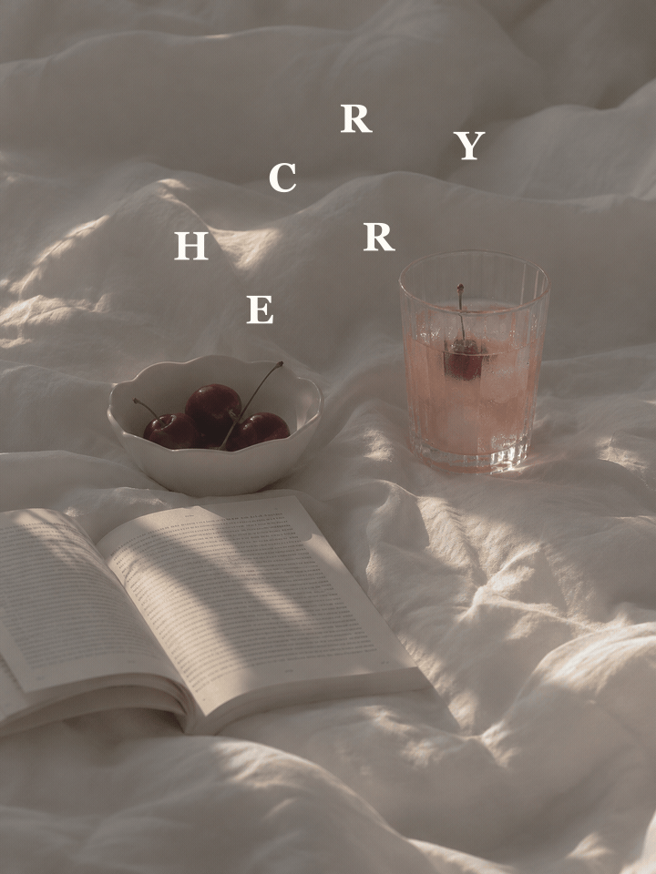<p><strong>流程更新测试</strong></p><p>樱桃饮料旁独立字母漂移、展开，气泡配合循环。</p><p><a href="examples/cherry-drift/animation.mp4">MP4</a> · <a href="examples/cherry-drift/animation.gif">GIF</a></p></td>
</tr>
</table>

<table>
<tr>
<td width="50%" valign="top"><h3>冷调街角 · 下一站书店</h3>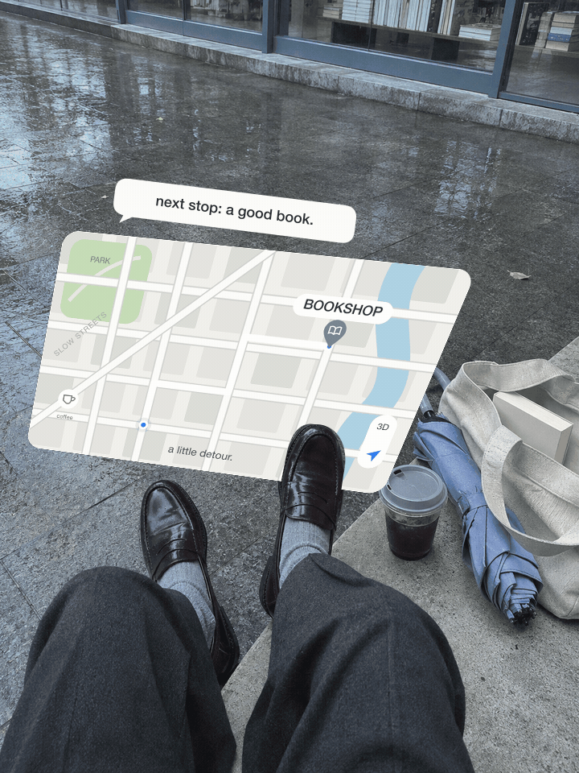<p><strong>近期案例</strong></p><p>地图以地面透视落位，鞋子在前景遮挡，路线依次出现。</p><p><a href="examples/next-stop-bookshop/animation.mp4">MP4</a> · <a href="examples/next-stop-bookshop/animation.gif">GIF</a></p></td>
<td width="50%" valign="top"><h3>Golden Hour · 灰色播放器</h3>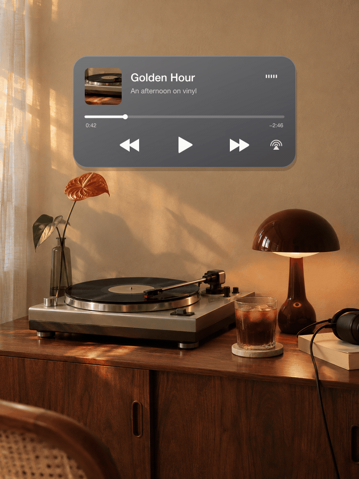<p><strong>近期案例</strong></p><p>暖光房间配大尺寸灰色音乐卡片，进度与播放状态变化。</p><p><a href="examples/golden-hour/animation.mp4">MP4</a> · <a href="examples/golden-hour/animation.gif">GIF</a></p></td>
</tr>
</table>

<table>
<tr>
<td width="50%" valign="top"><h3>蓝色画板 · 安静的乐谱</h3>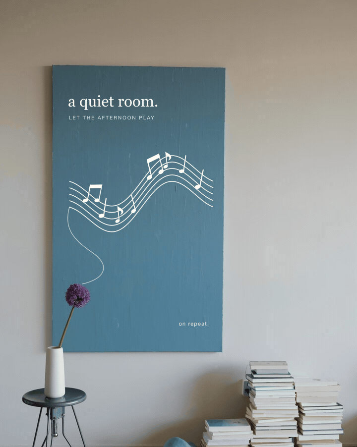<p><strong>近期案例</strong></p><p>大片蓝色留白承载流动白色乐谱，与花朵建立连接。</p><p><a href="examples/quiet-room-score/animation.mp4">MP4</a> · <a href="examples/quiet-room-score/animation.gif">GIF</a></p></td>
<td width="50%" valign="top"><h3>樱桃午后 · 云朵小人</h3>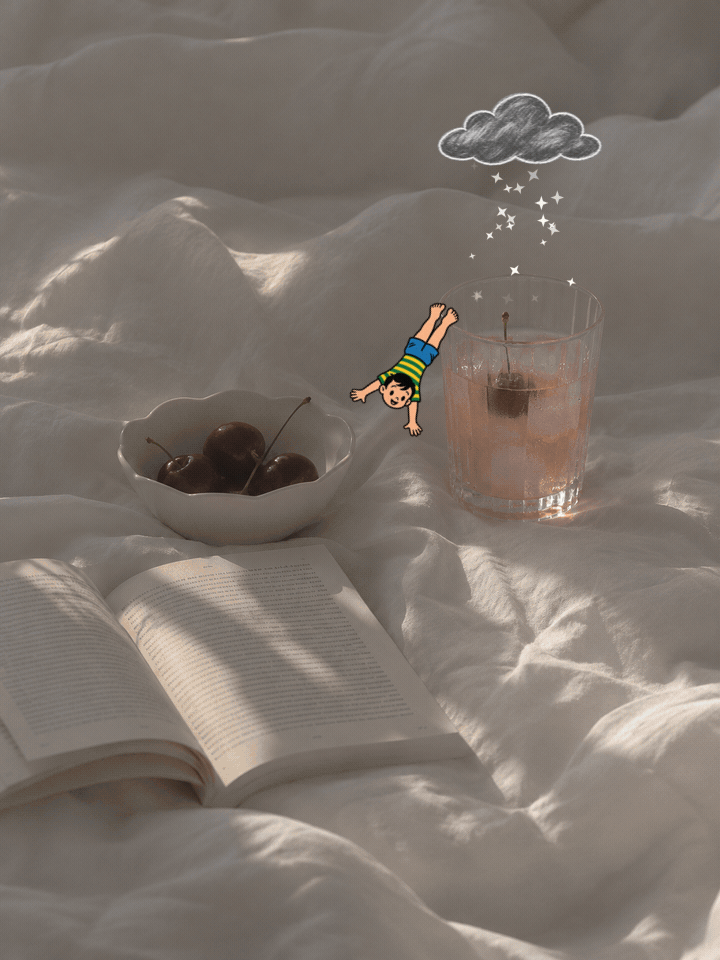<p><strong>近期案例</strong></p><p>手绘云朵、落星、悬挂小人与逐字短句组成循环。</p><p><a href="examples/sweeter-afternoon/animation.mp4">MP4</a> · <a href="examples/sweeter-afternoon/animation.gif">GIF</a></p></td>
</tr>
</table>

<table>
<tr>
<td width="50%" valign="top"><h3>苹果与书 · One More Chapter</h3>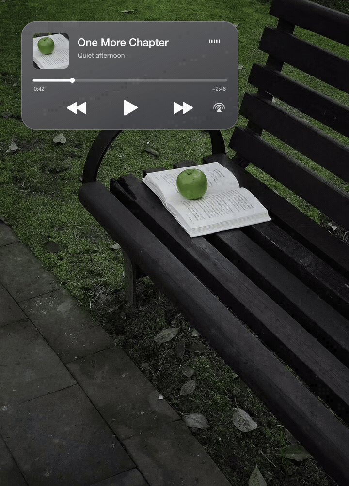<p><strong>改用既有效果</strong></p><p>苹果阅读场景适配中性灰播放器。</p><p><a href="examples/one-more-chapter/animation.mp4">MP4</a> · <a href="examples/one-more-chapter/animation.gif">GIF</a></p></td>
<td width="50%" valign="top"><h3>甜品独处 · iOS 专注模式</h3>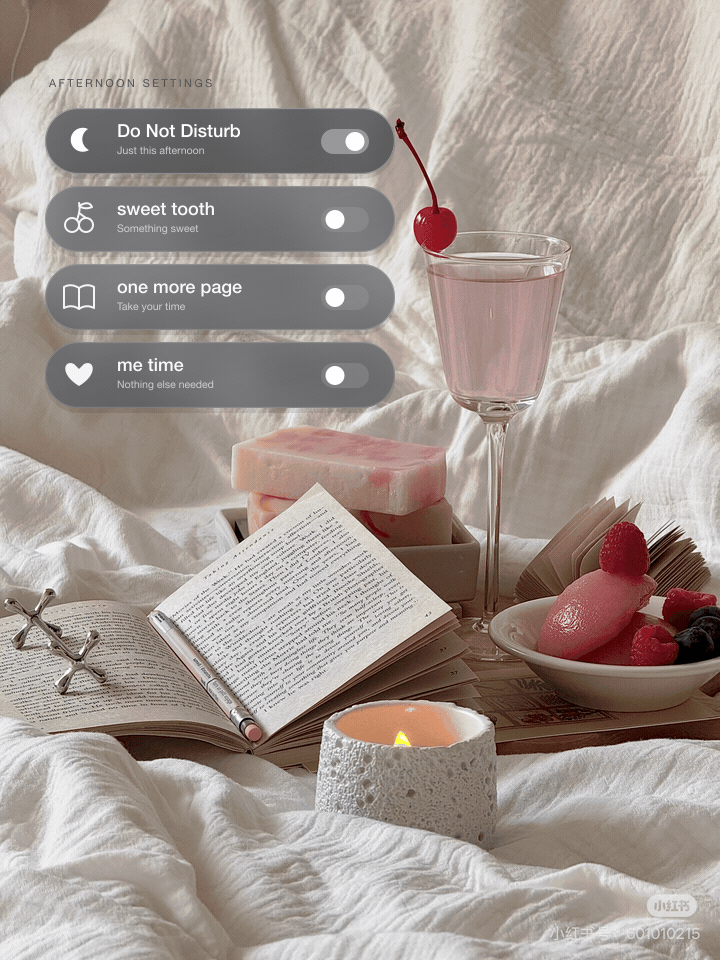<p><strong>配色修订版</strong></p><p>灰黑磨砂胶囊与白色选中态依次切换。</p><p><a href="examples/sweet-focus-ios/animation.mp4">MP4</a> · <a href="examples/sweet-focus-ios/animation.gif">GIF</a></p></td>
</tr>
</table>

<table>
<tr>
<td width="50%" valign="top"><h3>Slow Sunday · 粉色音乐页眉</h3>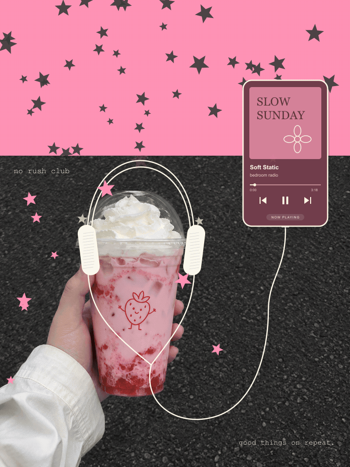<p><strong>参考复刻练习</strong></p><p>大粉色页眉、星星、耳机线和播放器组合。</p><p><a href="examples/slow-sunday/animation.mp4">MP4</a> · <a href="examples/slow-sunday/animation.gif">GIF</a></p></td>
<td width="50%" valign="top"><h3>Little Afternoon · 音乐雨</h3>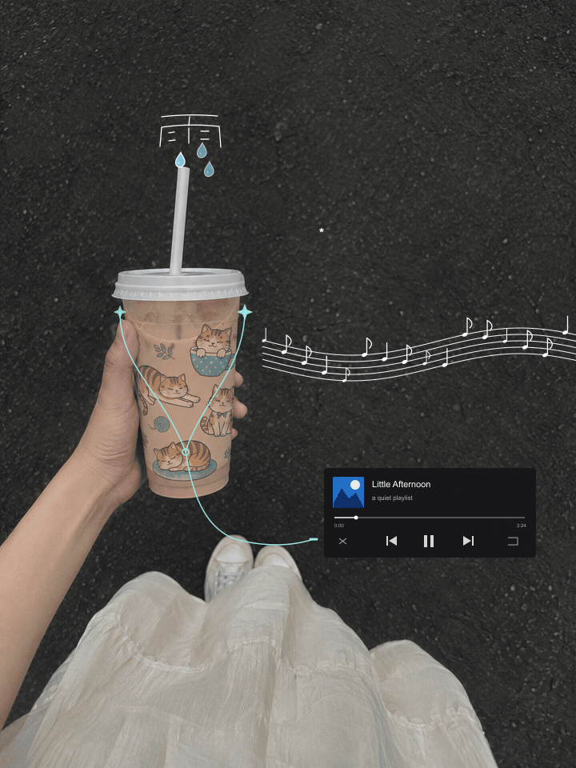<p><strong>参考复刻练习</strong></p><p>五线谱、耳机线、雨字与雨滴交织。</p><p><a href="examples/little-afternoon/animation.mp4">MP4</a> · <a href="examples/little-afternoon/animation.gif">GIF</a></p></td>
</tr>
</table>

<table>
<tr>
<td width="50%" valign="top"><h3>Own the Moment · 咖啡云朵</h3>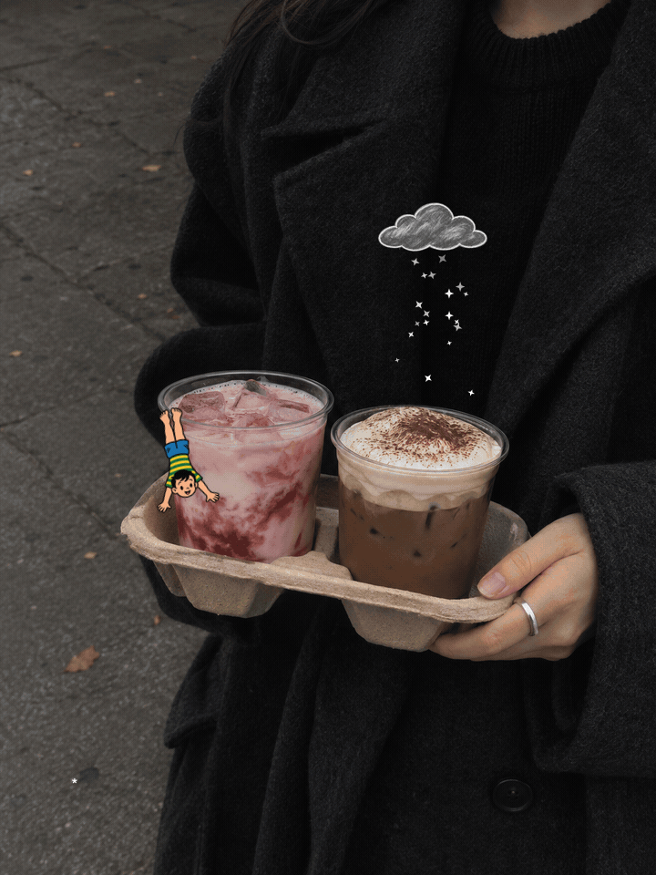<p><strong>参考复刻练习</strong></p><p>杯沿小人、云朵与落星形成手绘互动。</p><p><a href="examples/own-the-moment/animation.mp4">MP4</a> · <a href="examples/own-the-moment/animation.gif">GIF</a></p></td>
<td width="50%" valign="top"><h3>Coffee Pause · 数字连线杯 v2</h3><p><strong>时序与杯形修订</strong></p><p>对称杯形；线条到达后，数字才变为英文。</p><p><a href="examples/coffee-pause-v2/animation.mp4">MP4</a> · <a href="examples/coffee-pause-v2/animation.gif">GIF</a></p></td>
</tr>
</table>

<table>
<tr>
<td width="50%" valign="top"><h3>LIME · 找单词</h3>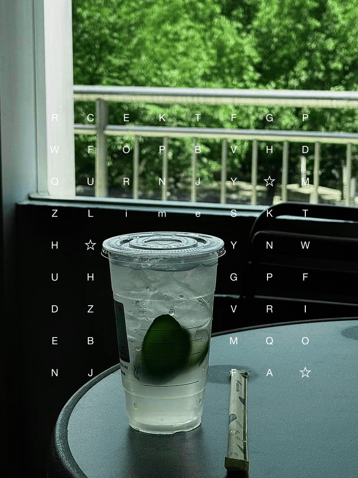<p><strong>早期参考练习</strong></p><p>字母网格、圈词与散落动作围绕饮料展开。</p><p><a href="examples/lime-wordsearch/animation.mp4">MP4</a> · <a href="examples/lime-wordsearch/animation.gif">GIF</a></p></td>
<td width="50%" valign="top"><h3>FLOWING · 独立漂移 v2</h3>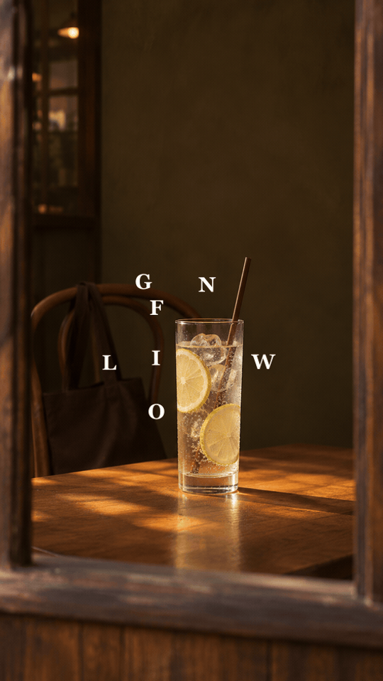<p><strong>针对环绕问题修订</strong></p><p>调整为独立字母漂移，配合气泡。</p><p><a href="examples/lemon-flowing-v2/animation.mp4">MP4</a> · <a href="examples/lemon-flowing-v2/animation.gif">GIF</a></p></td>
</tr>
</table>

<table>
<tr>
<td width="50%" valign="top"><h3>Off Duty · 音乐脚印</h3><p><strong>早期实验 · 尺度偏小</strong></p><p>卧室静物里脚印转为音乐元素。</p><p><a href="examples/off-duty-on-play/animation.mp4">MP4</a> · <a href="examples/off-duty-on-play/animation.gif">GIF</a></p></td>
<td width="50%" valign="top"><h3>Autumn on Board · 银杏</h3>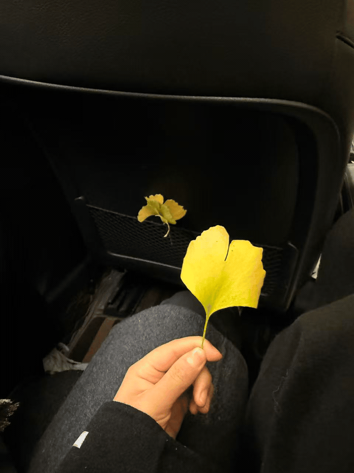<p><strong>早期实验 · 动效不够明显</strong></p><p>蝴蝶在两片银杏叶之间移动。</p><p><a href="examples/autumn-on-board/animation.mp4">MP4</a> · <a href="examples/autumn-on-board/animation.gif">GIF</a></p></td>
</tr>
</table>

<table>
<tr>
<td width="50%" valign="top"><h3>Sweet Focus · 初版</h3>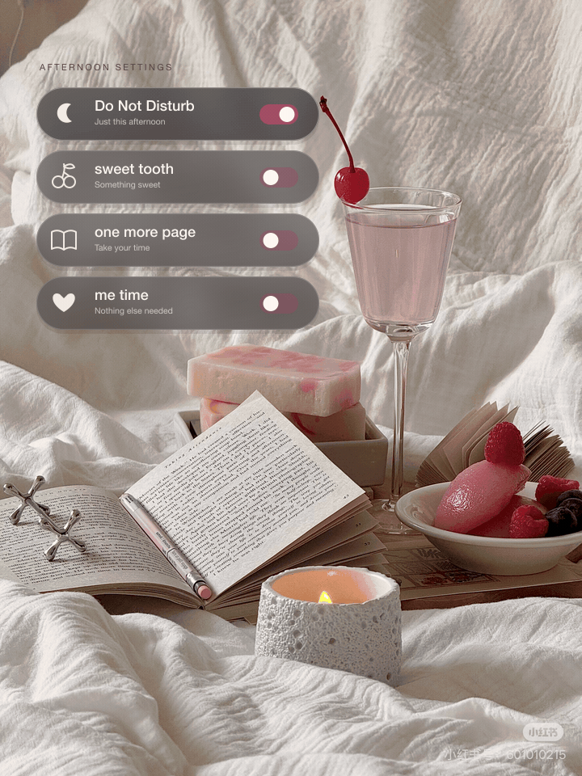<p><strong>历史反例 · 配色偏离 iOS</strong></p><p>甜品场景中的暖色专注胶囊。</p><p><a href="examples/sweet-focus/animation.mp4">MP4</a> · <a href="examples/sweet-focus/animation.gif">GIF</a></p></td>
<td width="50%" valign="top"><h3>Mental Battery · 灰色修订</h3>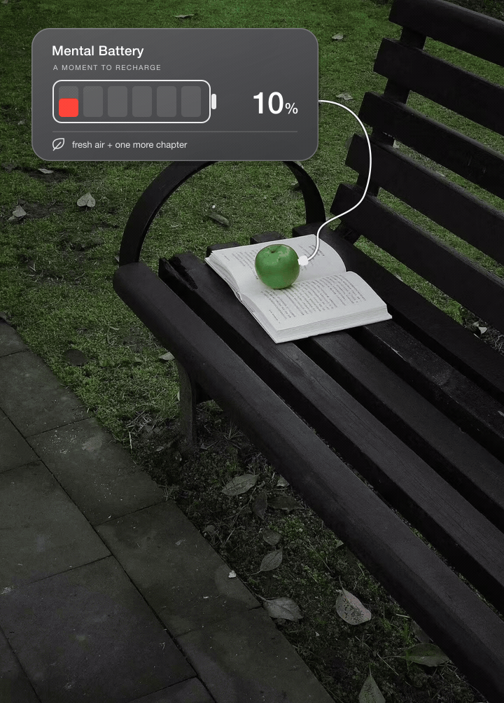<p><strong>历史反例 · 仅改色不够</strong></p><p>将电量卡片改为灰色，但效果家族仍不合要求。</p><p><a href="examples/mental-battery-ios/animation.mp4">MP4</a> · <a href="examples/mental-battery-ios/animation.gif">GIF</a></p></td>
</tr>
</table>

<table>
<tr>
<td width="50%" valign="top"><h3>Mental Battery · 初版</h3>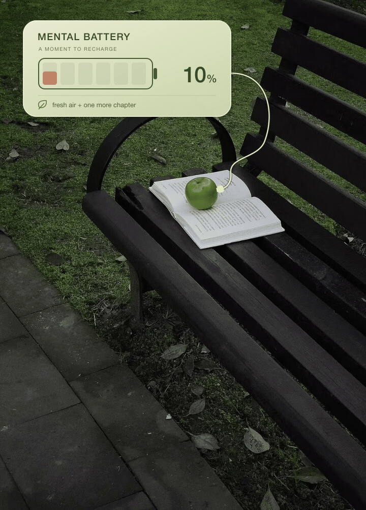<p><strong>历史反例 · 选型与配色不合要求</strong></p><p>苹果主题电量卡片与状态变化。</p><p><a href="examples/mental-battery/animation.mp4">MP4</a> · <a href="examples/mental-battery/animation.gif">GIF</a></p></td>
<td width="50%" valign="top"><h3>Coffee Pause · 初版</h3><p><strong>历史反例 · 杯形与触发时序</strong></p><p>数字与英文连线杯的首轮尝试。</p><p><a href="examples/coffee-pause/animation.mp4">MP4</a> · <a href="examples/coffee-pause/animation.gif">GIF</a></p></td>
</tr>
</table>

<table>
<tr>
<td width="50%" valign="top"><h3>FLOWING · 初版</h3>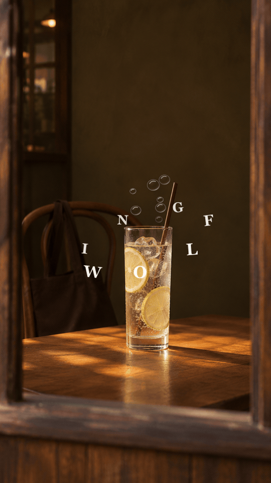<p><strong>历史反例 · 误读为环绕</strong></p><p>字母绕杯运动的首轮尝试。</p><p><a href="examples/lemon-flowing/animation.mp4">MP4</a> · <a href="examples/lemon-flowing/animation.gif">GIF</a></p></td>
<td width="50%" valign="top"><h3>Little Escape · 彩色小屋</h3>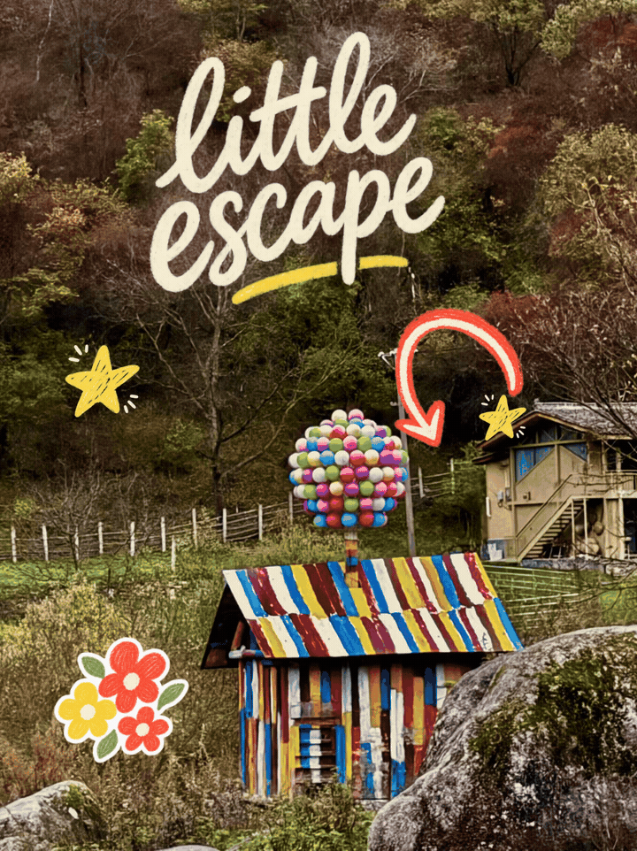<p><strong>历史实验 · 用户不满意</strong></p><p>手绘标题、星星、箭头与花朵装饰。</p><p><a href="examples/little-escape/animation.mp4">MP4</a> · <a href="examples/little-escape/animation.gif">GIF</a></p></td>
</tr>
</table>

## 生成底图与静态示例

以下是创作过程中生成的 7 张底图和 1 张静态示例。用户提供的照片不另行标成 AI 生成底图；中间调试帧、遮罩和测试文件不作为展示案例收录。

<table><tr>
<td width="50%"><strong>雨天咖啡底图</strong><br>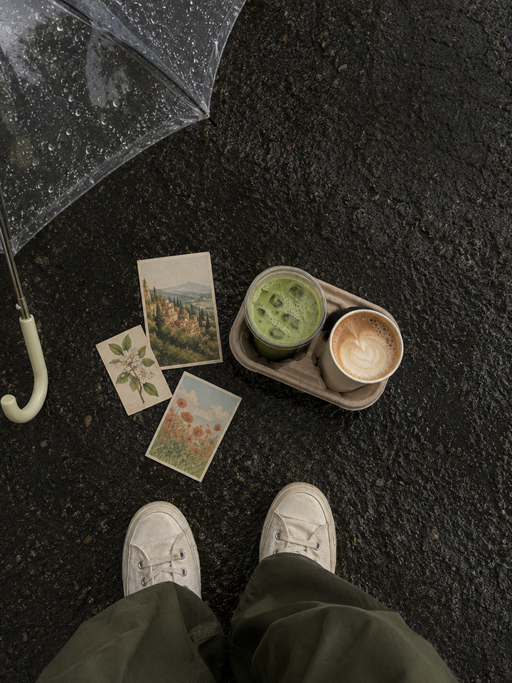</td>
<td width="50%"><strong>双杯手持底图</strong><br>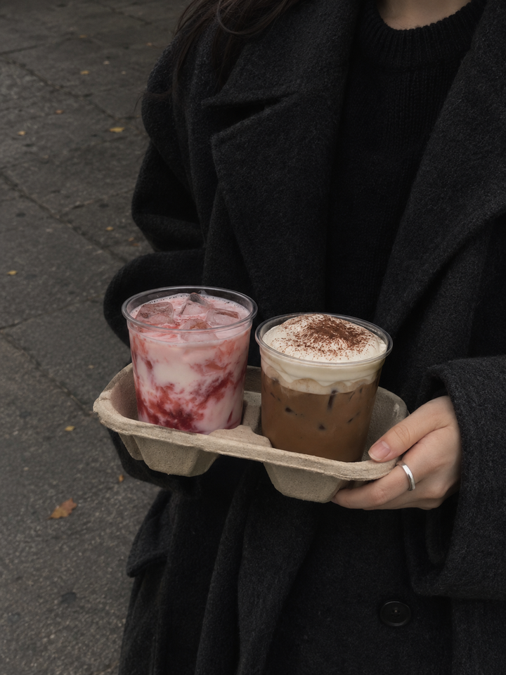</td>
</tr></table>

<table><tr>
<td width="50%"><strong>猫咪杯底图</strong><br>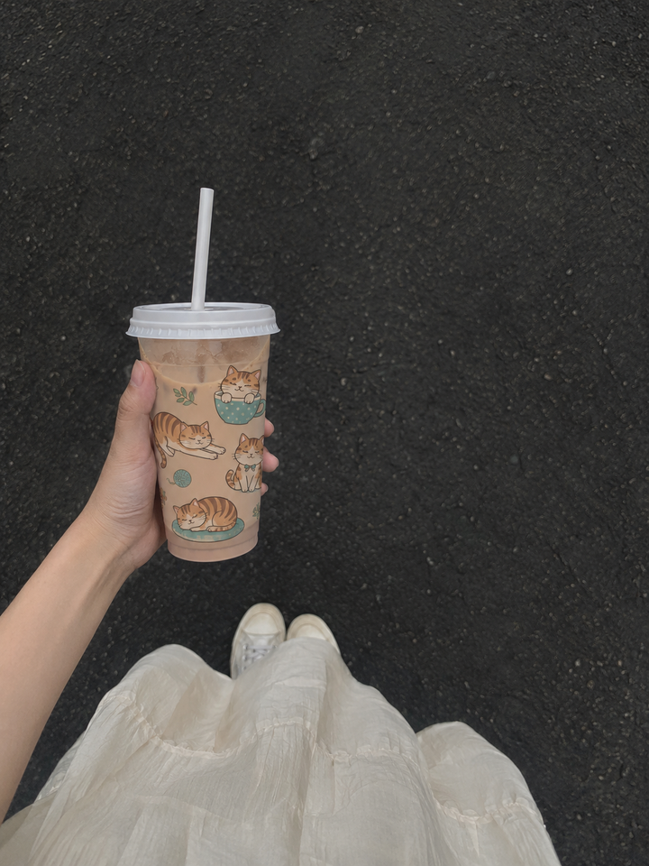</td>
<td width="50%"><strong>柠檬水底图</strong><br>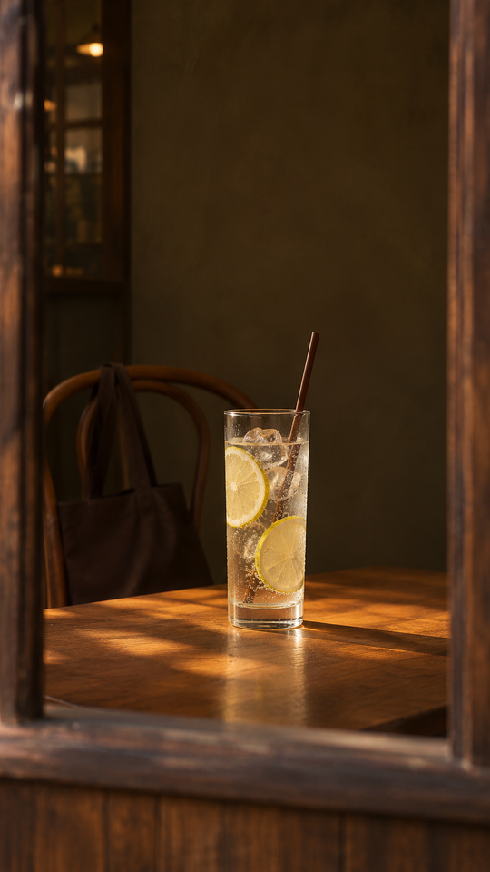</td>
</tr></table>

<table><tr>
<td width="50%"><strong>草莓饮料底图</strong><br>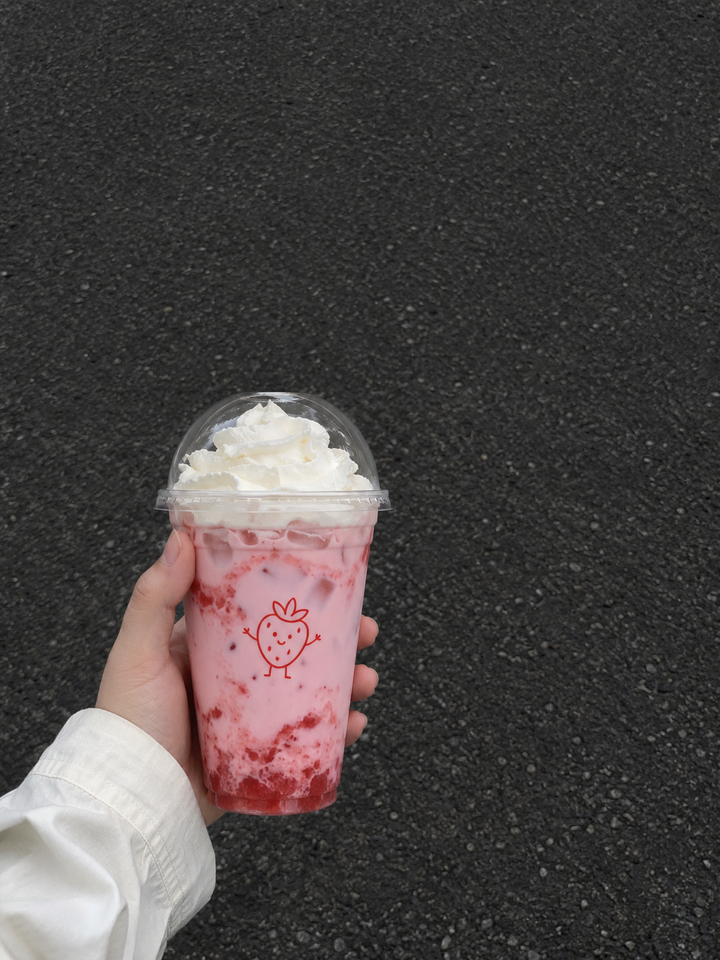</td>
<td width="50%"><strong>暖光听歌角落底图</strong><br>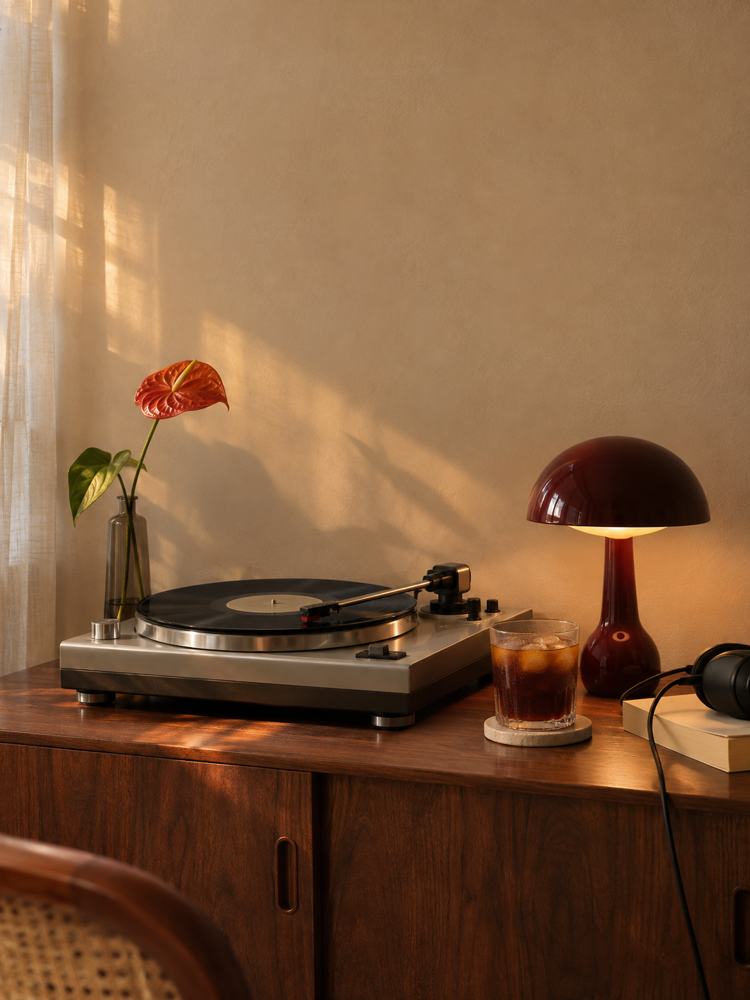</td>
</tr></table>

<table><tr>
<td width="50%"><strong>冷调书店街角底图</strong><br>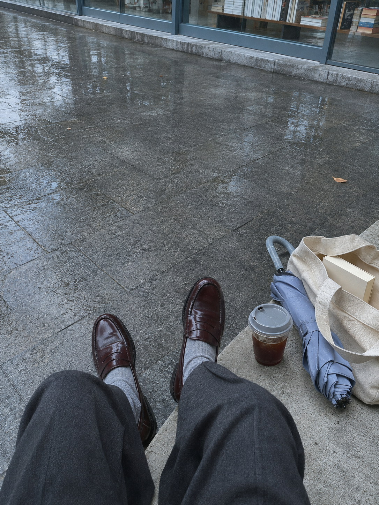</td>
<td width="50%"><strong>PAUSE 静态示例</strong><br>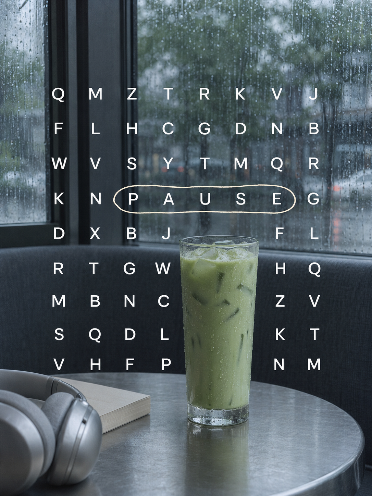</td>
</tr></table>

## 包内文件与工具

| 文件 | 用途 |
| --- | --- |
| [SKILL.md](SKILL.md) | Agent 入口、阶段路由与用户边界 |
| [production-workflow.md](references/production-workflow.md) | 完整制作流程 |
| [effect-library.md](references/effect-library.md) | 效果选择与可适配范围 |
| [media-index.md](references/media-index.md) | 参考图片 / 视频索引 |
| [casebook.md](references/casebook.md) | 历史反馈与应避免的错误 |
| [evaluation.md](references/evaluation.md) | 分项视觉与动作检查 |
| [ui-tokens.json](assets/ui-tokens.json) | 中性 UI 的基础参数 |
| [examples/index.json](examples/index.json) | 全部动图的机器可读索引 |

三个辅助脚本分别用于抽帧、编码和流程记录，不能替代审美判断或用户确认：

```bash
# 查看视频参考，生成接触表
python3 scripts/inspect_clip.py reference.mp4 --out-dir output/reference --count 12

# 将从 000.png 开始的连续帧输出为 GIF 与 MP4
python3 scripts/export_frames.py --frames-dir output/frames \
  --pattern '%03d.png' --fps 24 --out-dir output --stem ins-live

# 查看制作记录工具的使用方式
python3 scripts/check_project.py --help
```

## 来源与素材说明

流程设计借鉴了 [Hchen1218/heytea-style](https://github.com/Hchen1218/heytea-style) 的参考分工、视觉母版、定向修复和分项评估思路；保留 INS 动态照片这一用途，没有引入其海报、小怪兽或桌宠功能。具体说明见 [流程来源](references/process-source.md)。

参考视频 / 拼图来自用户提供的第三方学习素材；案例包含用户提供的照片与 AI 生成底图，叠加的动效由本次创作流程制作。它们的权利归属与使用范围见 [素材说明](ASSET-NOTICE.md)，请勿将第三方参考当作本仓库原创作品或通用商用素材包。
